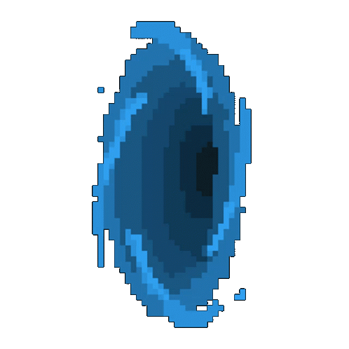

# Python Snake Game with Maze Generation



## Run
```
pip install -r requirements.txt
python src/game.py
```
Run the command from the repository root. The game reads `./res/config.json`.

## Overview
This project is a Python-based game that combines elements of the classic Snake game with maze generation and light simulation. Built using Pygame, it includes various features such as dynamic maze creation, lava lakes, forests, rivers.

## Goal
The goal is to create a complex version of the classic Snake game, incorporating traditional gameplay elements with dynamic maze features and BFS path-finding (an autonomous snake is a possible next step).

## Key Features
- **Snake Game**: Control a snake that grows in length as it eats apples. Avoid collisions with walls and the snake's own body.
- **Maze Generation**: The maze is generated using a depth-first search algorithm. The maze can be visualized as it’s created.
- **Dynamic Environment**: Features such as lava lakes, forests, and rivers are dynamically generated on the game map.
- **Path-finding**: A BFS path searcher finds routes through the maze.

## Files
- **`Game.py`**: Main game loop and initialization. Handles game setup, screen rendering, and user input.
- **`pathSearchers.py`**: Breadth-first search (BFS) path-finding on the map.
- **`Maze.py`**: Implements the maze generation algorithm and visualization.
- **`Snake.py`**: Defines the Snake and Apple classes, including movement, growth, and collision detection.
- **`Map.py`**: Manages the game map, including the generation of lava lakes, forests, and rivers.
- **`gridElements.py`**: Defines the `Cell` and `Block` classes used in the maze and map generation.

## Controls
- **Arrow keys** or **`WASD`**:  Control the snake's movement.
- **`T`**: Teleport the snake to a random position.
- **`G`**: Toggle ghost mode (snake becomes invincible).

## Configuration
The game configuration is stored in `config.json`. You can modify this file to adjust various settings such as:
- Map dimensions
- Colours
- Algorithm parameters
