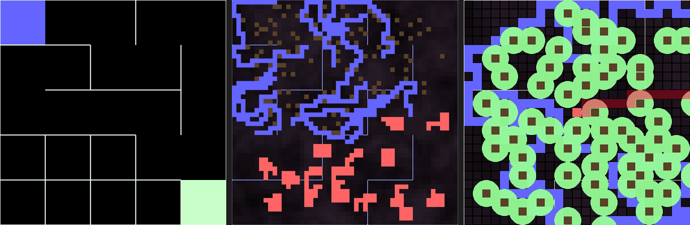

# Snake + Maze: a Python game with generated worlds

A Snake game in Python and Pygame. Each game builds a new world: a random maze, with lava lakes, forests and rivers on top. A BFS path search shows the way to the next apple, or to the exit.




*Left to right: the maze while it is generated; the full map with terrain; the game view with the BFS path in red.*

## Run
```
pip install -r requirements.txt
python src/game.py
```
Run the command from the repository root. The game reads `./res/config.json`.

## How it works

1. **Maze.** `src/maze.py` makes a grid of cells (5 x 5 in the default config) with all walls closed. It starts at the top-left cell and walks to a random unvisited neighbour. It removes the wall between the two cells. When the walk has no free neighbour, it takes a cell from the walk history and goes on. This is a random depth-first walk. It ends when every cell is visited. Run `python src/maze.py` from the repository root to watch it.
2. **Terrain.** `src/map.py` turns each maze cell into 10 x 10 blocks. It places random circles for forests and lava lakes. It adds a height map with simplex noise (the `noise` package) and draws rivers. Then it copies the maze walls to the block grid, but only where no lava, forest or river is. So terrain can open a gap in a wall.
3. **Path search.** `src/pathSearchers.py` runs breadth-first search (BFS) from the snake head. It stops at the nearest apple. Walls, the snake body, lava and trees block the search. Rivers do not block it. If no apple can be reached, it draws the longest path it found. When all apples are eaten, an exit opens in the border and BFS aims at the exit.

The game draws the BFS path in red. The snake does not follow it. You steer the snake.

## Files
- **`Game.py`**: Main game loop and initialization. Handles game setup, screen rendering, and user input.
- **`pathSearchers.py`**: Breadth-first search (BFS) path-finding on the map.
- **`Maze.py`**: Implements the maze generation algorithm and visualization.
- **`Snake.py`**: Defines the Snake and Apple classes, including movement, growth, and collision detection.
- **`Map.py`**: Manages the game map, including the generation of lava lakes, forests, and rivers.
- **`gridElements.py`**: Defines the `Cell` and `Block` classes used in the maze and map generation.

## Controls
- **Arrow keys** or **`WASD`**:  Control the snake's movement.
- **`T`**: Teleport the snake to a random position.
- **`G`**: Toggle ghost mode (snake becomes invincible).

## Configuration
The game configuration is stored in `res/config.json`. You can modify this file to adjust various settings such as:
- Map dimensions
- Colours
- Algorithm parameters

`apple_count` is 0 in the default config. With 0 apples the exit opens at the start, and BFS draws the path to it. Set a higher number to play with apples first.

## Make the strip image
`tools/make_strip.py` makes `docs/pipeline.png` by running the game code without a window:
```
uv run --python 3.12 --with pygame --with noise --with pillow tools/make_strip.py
```

## Status
A finished hobby project. The snake is not autonomous yet.

## License
MIT, see `LICENSE`.

Part of my portfolio: https://ilyaeis.github.io
